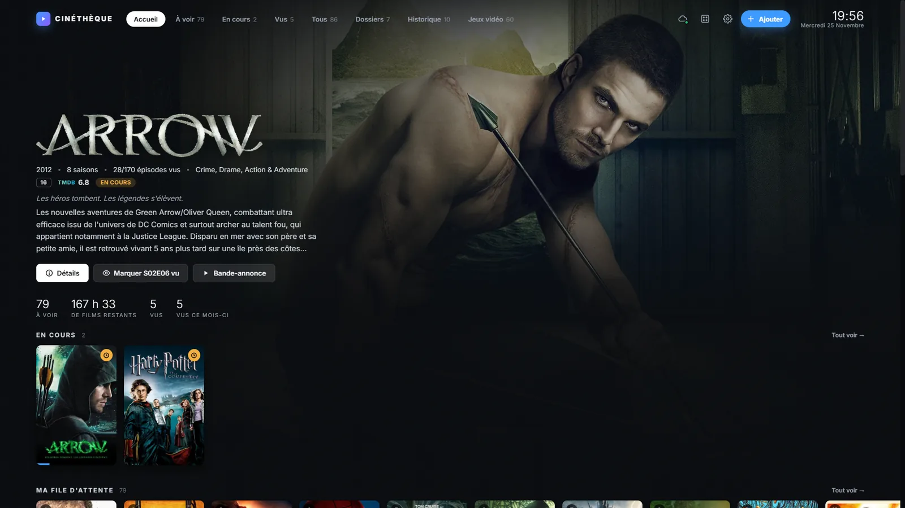
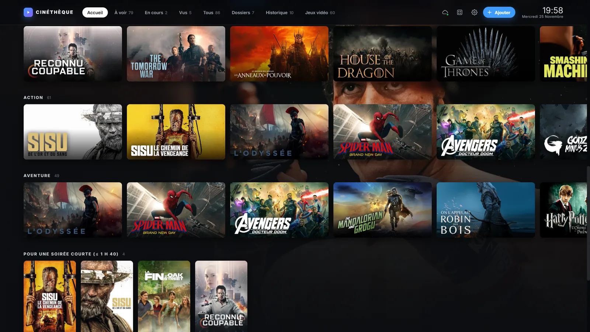
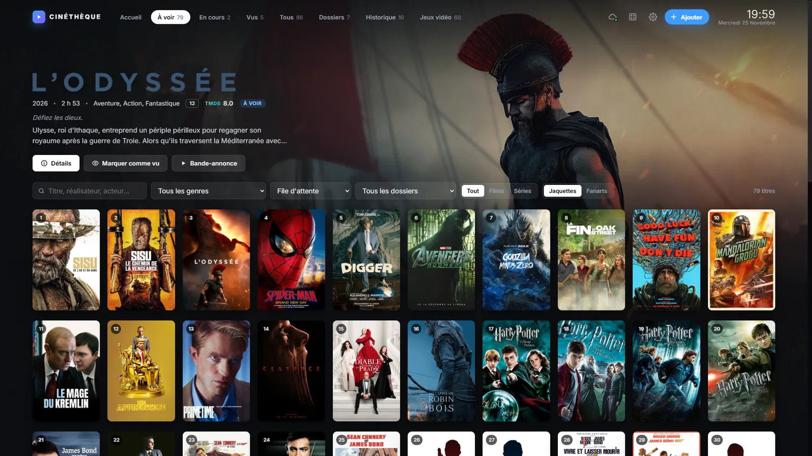
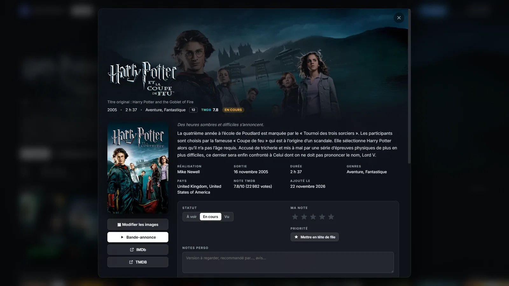
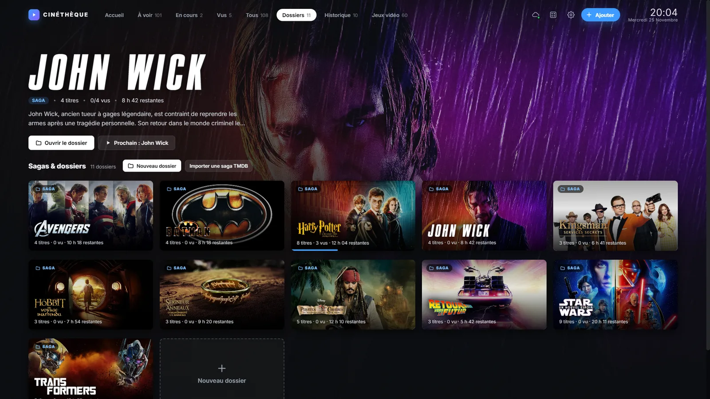
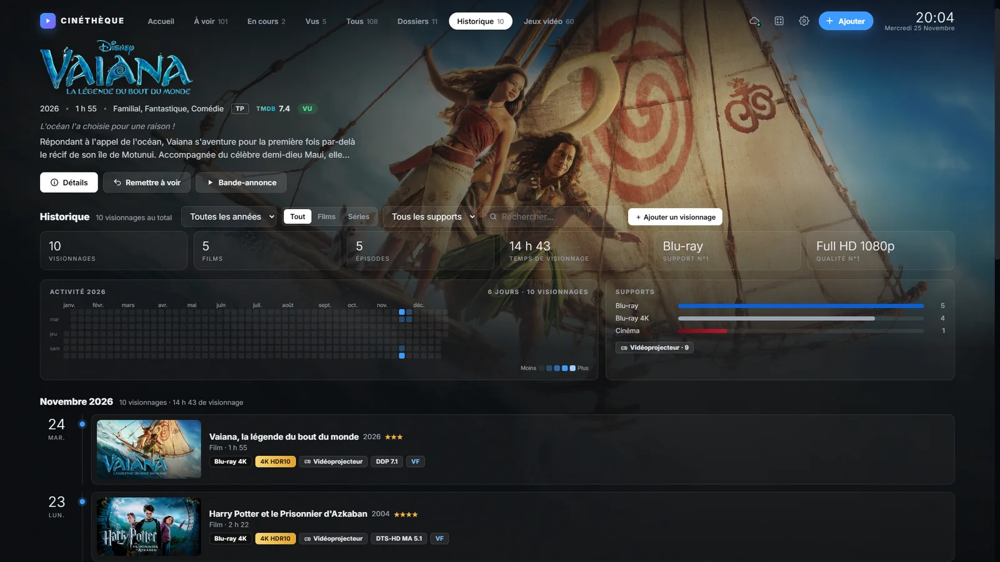
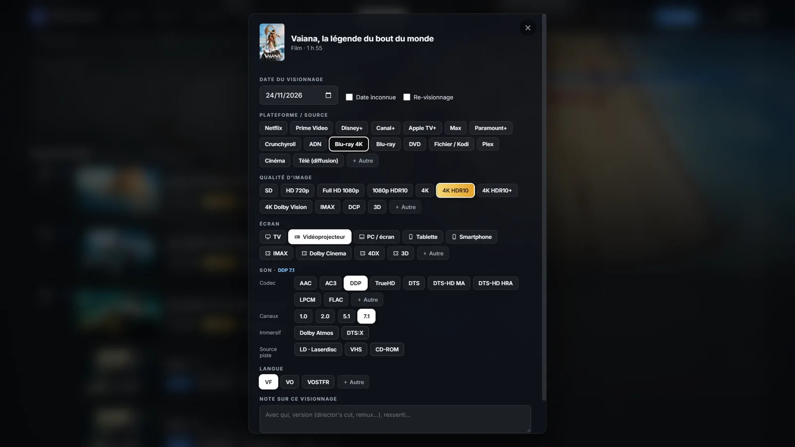
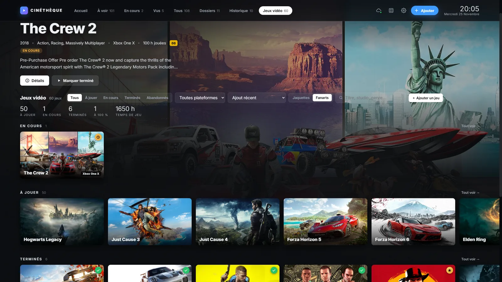
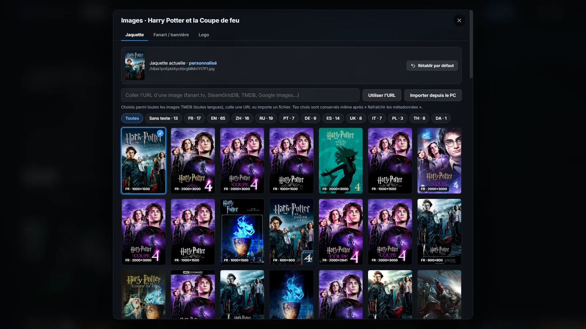
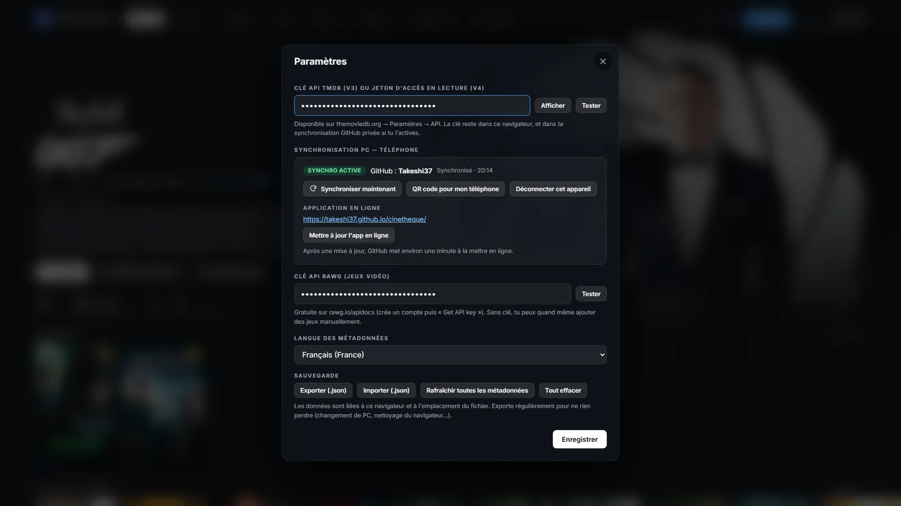

# 🎬 Cinéthèque

**Ton suivi personnel de films, séries et jeux vidéo, dans l'esprit de Kodi (skin Arctic Fuse 3).**
Une seule app, sur ton PC et ton téléphone, synchronisée entre les deux. Gratuite, sans pub, sans abonnement, et sans compte à créer chez quelqu'un d'autre : **tes données restent chez toi**.

> Tu as reçu un lien vers l'app ? Va directement au [Démarrage](#démarrage-une-seule-fois-environ-10-minutes). Tu arrives sur une app **vide** : personne ne voit ta liste, et tu ne vois celle de personne.

---

## Sommaire

- [Ce que fait l'application](#ce-que-fait-lapplication)
- [Démarrage (une seule fois)](#démarrage-une-seule-fois-environ-10-minutes)
- [Installer l'app sur ton téléphone et ton PC](#installer-lapp-sur-ton-téléphone-et-ton-pc)
- [Au quotidien](#au-quotidien)
- [Raccourcis clavier](#raccourcis-clavier)
- [Tes données : confidentialité et sauvegarde](#tes-données--confidentialité-et-sauvegarde)
- [Problèmes fréquents](#problèmes-fréquents)
- [Crédits](#crédits)

---

## Ce que fait l'application

### Accueil
- Un grand **fanart** plein écran change au survol de chaque titre, avec son **logo**, l'année, la durée, les genres, la classification, la **note TMDB** et le résumé. Des boutons permettent d'ouvrir la fiche, de marquer comme vu ou de lancer la bande-annonce.
- Des rangées de jaquettes :
  - **En cours** ;
  - **Ma file d'attente**, numérotée ;
  - **Mes sagas & dossiers** ;
  - **Ajoutés récemment** ;
  - tes **genres** les plus présents ;
  - **Pour une soirée courte** (1 h 40 maximum) ;
  - **Vus récemment**.
- Des statistiques en un coup d'œil : nombre de titres à voir, temps de film restant, nombre de vus, vus ce mois-ci.
- Le bouton **« Au hasard »** (le dé) tire un film de ta liste « À voir » quand tu n'arrives pas à choisir.

*Les rangées de l'accueil : ajoutés récemment, tes genres, soirée courte…*

### Ajouter des films et des séries
- Il y a trois façons d'ajouter un titre :
  - **un code IMDb** (comme tt0137523), **un code TMDB** (comme 550), ou un lien IMDb ou TMDB copié depuis ton navigateur ;
  - **l'import en masse** : tu colles une liste, un titre par ligne, et tout est ajouté d'un coup. L'ordre de la liste devient ta file d'attente.
  - **la recherche par titre**.
- Les jaquettes, fanarts, logos, le résumé (en français), le casting, la bande-annonce, la durée et la note sont récupérés automatiquement.
- Tu peux ajouter un titre en « À voir » ou en « Déjà vu », et le ranger directement dans un dossier.

*La liste « À voir », numérotée comme une file d'attente, avec filtres et tri.*

### La fiche d'un titre
- La fiche affiche une bannière avec le logo, le résumé, le réalisateur, la date de sortie, la durée, le pays et la note.
- Le **casting** est présenté avec les photos des acteurs, et des liens mènent à la **bande-annonce**, à IMDb et à TMDB.
- Pour chaque titre, tu peux :
  - choisir un statut (**À voir**, **En cours** ou **Vu**) et la date du visionnage ;
  - lui donner **ta note** (de 1 à 5 étoiles) ;
  - le **mettre en tête de file** ;
  - écrire des **notes perso** (version à regarder, qui te l'a conseillé…).

*La fiche d'un film : logo, résumé, infos, statut, note et notes perso.*

### Séries : saison par saison, épisode par épisode
- Chaque saison peut se déplier. Tu y trouves la liste des épisodes avec leur image, leur titre, leur date et leur résumé, et une case à cocher pour chacun.
- Le bouton **« Saison vue »** coche une saison entière d'un coup.
- Le bouton **« Vu jusqu'ici »** coche un épisode et tous ceux d'avant, saisons précédentes comprises. C'est pratique si tu reprends une série en cours de route.
- Une barre de progression indique où tu en es, avec le **prochain épisode à voir** et la date du prochain épisode diffusé.
- Le statut change tout seul :
  - la série passe en « En cours » dès le premier épisode coché ;
  - elle passe en « Vu » quand tu es à jour ;
  - elle repasse en « En cours » quand de nouveaux épisodes sortent.
- Sur l'accueil, le bouton **« Marquer S02E05 vu »** te permet d'avancer sans ouvrir la fiche.

### Sagas & dossiers
- Le bouton **« Importer une saga »** fonctionne pour les sagas officielles : James Bond, Harry Potter, Le Seigneur des anneaux, etc. Tous les films déjà sortis sont ajoutés, dans l'ordre de sortie.
- Tu peux aussi créer des **dossiers manuels** pour tout le reste : Marvel, DC, un réalisateur, un thème… Un même film peut se trouver dans plusieurs dossiers.
- Les sagas affichent automatiquement leur **logo** (modifiable dans « Images… »).
- Les films d'un dossier sont **numérotés**. Tu peux les trier dans ton ordre perso (en faisant glisser les jaquettes), par date de sortie ou par titre.
- Chaque dossier affiche sa progression (films vus sur le total), le temps restant et un bouton **« Prochain »**.

*Les sagas et dossiers, avec leur logo et leur progression.*

### Historique de visionnage
- Quand tu marques un film comme vu, une petite fenêtre te demande :
  - **la date** ;
  - **la plateforme** : Netflix, Prime Video, Disney+, Canal+, Apple TV+, Max, Bravia Core, Blu-ray 4K, Cinéma… ;
  - **le lecteur** : Shield, Ugoos, Zidoo, Dune HD, Apple TV, Fire TV Stick, Xbox, PlayStation, lecteur Blu-ray 4K… ;
  - **la qualité** : 1080p, 1080p HDR10, 4K HDR, Dolby Vision, IMAX, DCP, 3D… ;
  - **l'écran** : TV, vidéoprojecteur, IMAX, Dolby Cinema, 4DX, 3D… (au cinéma, la source « Cinéma » suffit pour une salle classique) ;
  - **le son**, composé comme dans un nom de release : codec (DDP, TrueHD, DTS-HD MA, LPCM…), canaux (2.0, 5.1, 7.1), son immersif (Dolby Atmos ou DTS:X) et source de la piste (LD, VHS, CD-ROM). Ça donne par exemple « DDP 5.1 Atmos » ;
  - **la langue** : VF, VO, VOSTFR.

  Chaque liste a un bouton « + Autre » pour ajouter tes propres choix. La fenêtre est **pré-remplie avec ton dernier support**.
- Les épisodes de séries sont enregistrés automatiquement, sans fenêtre.
- La page Historique affiche :
  - une **frise** par mois et par jour, avec des badges colorés ;
  - des **statistiques** : visionnages, temps total, support favori ;
  - un **calendrier de l'année** qui montre tes jours de visionnage ;
  - la répartition par support ;
  - des filtres et une recherche.
- Tu peux aussi **ajouter un visionnage passé** à la main et marquer un **re-visionnage**.

*L'historique : statistiques, calendrier de l'année, supports et frise des visionnages.*

*La fenêtre de visionnage : date, source, qualité, écran, son façon release et langue.*

### Jeux vidéo
- Les jeux s'ajoutent par une recherche dans une base de plus de 500 000 jeux (RAWG), ou manuellement.
- Chaque jeu a un statut : **À jouer**, **En cours**, **Terminé**, **100 %** ou **Abandonné**. Les dates de début et de fin se remplissent toutes seules.
- Tu peux noter ta plateforme, ton **temps de jeu**, ta note et des notes perso.
- La fiche du jeu affiche la note Metacritic, le studio, les plateformes, la durée moyenne et les **captures d'écran**. Chaque capture peut servir de fanart en un clic.

*L'onglet jeux vidéo : à jouer, en cours, terminés, temps de jeu.*

### Personnaliser toutes les images (comme sur Jellyfin)
- Pour **chaque film, série, jeu ou dossier**, tu peux changer la **jaquette**, le **fanart (bannière)** et le **logo**.
- Tu peux choisir parmi toutes les images TMDB (toutes langues, avec un filtre « Sans texte »), **coller l'adresse d'une image** (fanart.tv, SteamGridDB, Google Images…) ou **importer une image depuis ton PC**.
- Tes choix sont conservés même après une mise à jour des fiches. Le bouton « Rétablir par défaut » revient à l'image d'origine.

*L'éditeur d'images : toutes les jaquettes, fanarts et logos de TMDB, filtrables par langue.*

### Une vraie app, synchronisée
- Tu l'installes sur ton **téléphone** et ton **PC** avec une icône, et elle s'ouvre en plein écran.
- La **synchronisation est automatique**. Le petit nuage en haut indique son état :
  - vert : tout est synchronisé ;
  - orange : un envoi est en attente ;
  - rouge : il y a un problème.
- Les images déjà vues sont gardées en mémoire, et l'app s'ouvre même sans connexion.

---

## Démarrage (une seule fois, environ 10 minutes)

### Étape 1 : ouvrir l'app
Ouvre le lien qu'on t'a envoyé :
- dans **Chrome** sur PC et sur Android ;
- dans **Safari** sur iPhone.

Au premier lancement, les **Paramètres** (la roue crantée ⚙) s'ouvrent tout seuls.

### Étape 2 : la clé TMDB (obligatoire, gratuite)
C'est elle qui donne accès aux jaquettes, aux résumés et aux fiches des films et des séries.
1. Crée un compte sur **[themoviedb.org](https://www.themoviedb.org/signup)** et valide ton adresse e-mail.
2. Va dans **[Paramètres → API](https://www.themoviedb.org/settings/api)**, puis clique sur « Créer » ou « Demander une clé d'API ». Choisis **« Developer »** et accepte les conditions.
3. Remplis le petit formulaire. Indique un usage personnel ; pour le site, tu peux mettre l'adresse de l'app.
4. Copie la **« Clé d'API (v3) »** ou le **« Jeton d'accès en lecture (v4) »**. Les deux fonctionnent.
5. Dans l'app, va dans **⚙ Paramètres**, colle la clé, clique sur **Tester**, puis sur **Enregistrer**.

### Étape 3 : la clé RAWG (facultatif, pour les jeux vidéo)
1. Va sur **[rawg.io/apidocs](https://rawg.io/apidocs)** et clique sur **« Get API key »**. Crée un compte et remplis le formulaire (usage personnel).
2. Copie la clé, puis colle-la dans **⚙ Paramètres → Clé API RAWG** et clique sur **Enregistrer**.

Sans cette clé, tu peux quand même ajouter des jeux à la main.

### Étape 4 : la synchronisation PC ↔ téléphone (facultatif, mais conseillé)
Tes données sont gardées dans ton propre compte GitHub, gratuit, dans un espace secret.
1. Crée un compte sur **[github.com](https://github.com/signup)** si tu n'en as pas.
2. Dans l'app, va dans **⚙ Paramètres → Synchronisation PC ↔ téléphone** et clique sur le lien **« Crée ta clé d'accès »**. GitHub s'ouvre avec les bonnes cases déjà cochées.
   - Pour **Expiration**, choisis **« No expiration »**.
   - Clique sur **« Generate token »** en bas de la page.
   - **Copie tout de suite la clé** (elle commence par ghp_). GitHub ne l'affiche qu'une seule fois.
3. Reviens dans l'app, colle la clé, puis clique sur **« Connecter »**. Le nuage en haut passe au vert.

> Le bouton « Créer ma propre copie sur mon GitHub » ne sert pas pour utiliser l'app. Il te donne ta propre adresse, indépendante de celle qu'on t'a envoyée (voir [Problèmes fréquents](#problèmes-fréquents)).

*Les paramètres : clés API, synchronisation GitHub et application en ligne.*

---

## Installer l'app sur ton téléphone et ton PC

Commence par faire les étapes 1 à 4 sur ton **PC**.

### Android
1. Sur le PC, va dans **⚙ Paramètres → Synchronisation**, clique sur **« QR code pour mon téléphone »** et laisse l'onglet **« Android / PC »**.
2. **Scanne le code** avec l'appareil photo du téléphone. L'app s'ouvre **déjà connectée**, avec toute ta liste et tes clés.
3. Dans le menu **⋮** de Chrome, choisis **« Ajouter à l'écran d'accueil »** ou **« Installer l'application »**.

### iPhone
Sur iPhone, l'app installée sur l'écran d'accueil ne partage pas les données de Safari. Il faut donc la connecter **depuis l'icône** :
1. Ouvre le lien de l'app dans **Safari**, touche **Partager** (le carré avec une flèche), puis **« Sur l'écran d'accueil »**.
2. **Ouvre l'app depuis sa nouvelle icône.**
3. Sur le PC, va dans **⚙ Paramètres → Synchronisation → « QR code pour mon téléphone »** et choisis l'onglet **« iPhone (clé seule) »**.
4. Scanne le code avec l'appareil photo, puis touche le texte qui apparaît pour le **copier**.
5. Dans l'app, va dans **⚙ Paramètres → Synchronisation**, colle la clé, puis clique sur **« Connecter »**. Toute ta liste arrive.

### PC (Windows ou Mac)
Ouvre le lien de l'app dans **Chrome** ou **Edge**, puis clique sur l'icône **« Installer »** dans la barre d'adresse (un petit écran avec une flèche). L'app a alors sa propre fenêtre et son icône dans le menu Démarrer.

> ⚠️ **Ne partage jamais ton QR code ni ta clé GitHub** : ils donnent accès à tes données.

---

## Au quotidien

| Tu veux… | Comment faire |
|---|---|
| Ajouter un film ou une série | Bouton **+ Ajouter** (ou touche A), puis colle un code IMDb ou TMDB, un lien, une liste, ou cherche par titre |
| Marquer un film comme vu | Bouton **« Marquer comme vu »** (sur l'accueil ou dans la fiche), puis indique le support et la date |
| Avancer dans une série | Bouton **« Marquer S01E04 vu »** sur l'accueil, ou coche les épisodes dans la fiche |
| Ranger un film dans un dossier | Dans sa fiche, section **Dossiers** : clique sur le dossier voulu, ou sur « + Nouveau dossier » |
| Importer une saga complète | Dans la fiche d'un film de la saga, clique sur **« Importer la saga »**, ou va dans l'onglet Dossiers puis « Importer une saga TMDB » |
| Changer une jaquette, un fanart ou un logo | Dans la fiche, clique sur la jaquette ou sur **« Modifier les images »** |
| Corriger le support d'un visionnage | Dans l'onglet **Historique**, survole la ligne puis clique sur le crayon ✎ |
| Ne pas savoir quoi regarder | Bouton **dé** (ou touche R) |
| Forcer la synchronisation | **⚙ Paramètres → Synchronisation → « Synchroniser maintenant »** |

Tu peux modifier ta liste sur le PC puis ouvrir l'app sur le téléphone : elle se met à jour toute seule en quelques secondes. Si tu as modifié les deux appareils sans connexion, l'app te demande quelle version garder.

---

## Raccourcis clavier

| Touche | Action |
|---|---|
| ← → ↑ ↓ | Se déplacer entre les jaquettes, comme dans Kodi |
| Entrée | Ouvrir la fiche |
| Échap | Fermer la fenêtre ouverte |
| A | Ajouter un film, une série ou un jeu |
| R | Tirer au hasard dans la liste « À voir » |
| / | Aller à la recherche |
| Suppr | Retirer un film du dossier (dans un dossier) |

---

## Tes données : confidentialité et sauvegarde

- **Tout reste chez toi.** Ta liste, ton historique, tes jeux et tes clés sont enregistrés dans ton navigateur et dans ton propre GitHub (si tu actives la synchro). **Personne d'autre n'y a accès, pas même la personne qui t'a envoyé le lien.** L'app en ligne ne contient que du code.
- La synchro utilise un **gist secret** dans ton compte GitHub. Il n'est pas listé publiquement et n'est accessible qu'avec son adresse exacte, qui n'apparaît nulle part.
- **Fais une sauvegarde de temps en temps.** Va dans **⚙ Paramètres → Exporter (.json)** : le fichier contient toute ta liste, tes dossiers, ton historique et tes jeux. Tu peux le réimporter avec « Importer (.json) ».
- Les images que tu **importes depuis ton PC** prennent de la place dans le navigateur, qui est limitée à quelques Mo. Quand c'est possible, préfère coller l'adresse d'une image.

---

## Problèmes fréquents

**Les jaquettes ne s'affichent pas, ou le message « Clé API TMDB manquante » apparaît**
Ta clé TMDB n'est pas renseignée ou elle est mal copiée. Va dans ⚙ Paramètres, recolle la clé, puis clique sur **Tester**.

**Le message « Clé GitHub invalide ou expirée » apparaît**
Ta clé a été supprimée ou a expiré. Recrée-la (étape 4), puis va dans ⚙ Paramètres → Synchronisation, clique sur « Déconnecter cet appareil » et reconnecte-toi avec la nouvelle clé.

**Le nuage est rouge**
Tu es probablement hors connexion. La synchro reprend toute seule dès que le réseau revient. Tu peux aussi cliquer sur « Synchroniser maintenant ».

**Je ne vois pas mes données sur le téléphone**
Vérifie que le téléphone est bien connecté : ⚙ Paramètres → Synchronisation doit afficher « Synchro active ». Sur iPhone, la connexion doit se faire **dans l'app ouverte depuis son icône**, pas dans Safari.

**L'app me demande quelle version garder**
Tu as modifié ta liste sur deux appareils sans qu'ils puissent se synchroniser entre-temps. Choisis l'appareil qui a les modifications les plus importantes.

**Les descriptions des jeux sont en anglais**
C'est normal : la base RAWG est surtout en anglais. Les films et les séries, eux, sont en français.

**Il n'y a pas de jaquette verticale ni de logo pour un jeu**
RAWG n'en fournit pas. Va sur **[steamgriddb.com](https://www.steamgriddb.com)**, cherche le jeu, puis fais un clic droit sur l'image (onglets Grids ou Logos) et choisis « Copier l'adresse de l'image ». Colle-la ensuite dans « Modifier les images ».

**Une nouvelle version de l'app est sortie, mais je vois l'ancienne**
Ferme l'app et rouvre-la, ou recharge la page. Elle se met à jour toute seule dès que la version en ligne change.

**Je veux ma propre copie, indépendante du lien qu'on m'a donné**
Ta clé GitHub doit avoir la case « public_repo » cochée. Va dans ⚙ Paramètres → Synchronisation et clique sur **« Créer ma propre copie sur mon GitHub »**. Ton app sera disponible à l'adresse **https://tonpseudo.github.io/cinetheque/** au bout d'une à deux minutes. Tes données restent les mêmes : elles sont dans ton GitHub.

---

## Crédits

- Les données des films et des séries viennent de **[TMDB](https://www.themoviedb.org)**. *Ce produit utilise l'API TMDB mais n'est ni approuvé ni certifié par TMDB.*
- Les données des jeux vidéo viennent de **[RAWG](https://rawg.io)**.
- La génération des QR codes utilise **qrcode-generator** de Kazuhiko Arase (licence MIT).
- La police est **Inter**.
- Le design est inspiré du skin **Arctic Fuse 3** pour Kodi.
